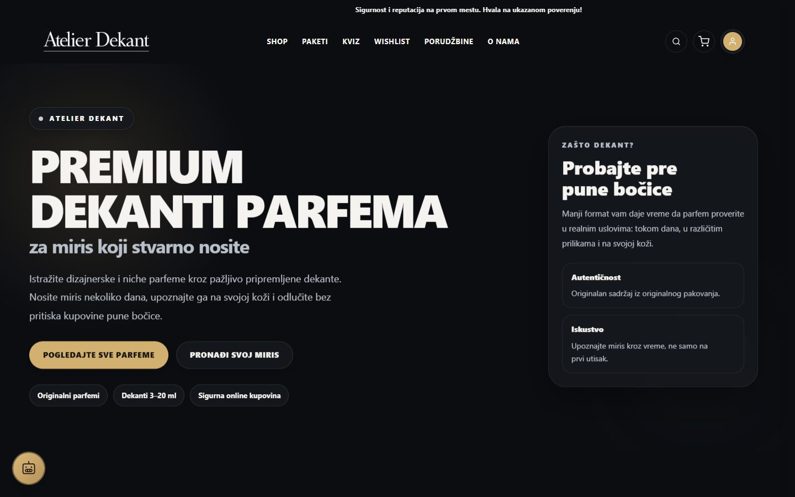
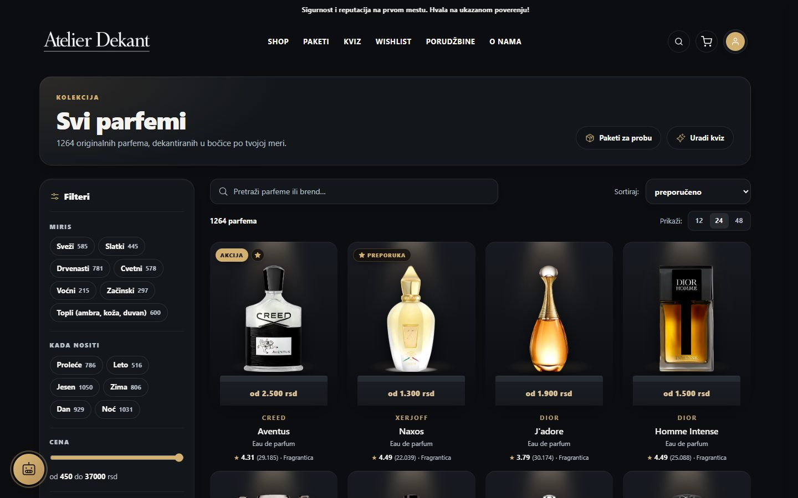
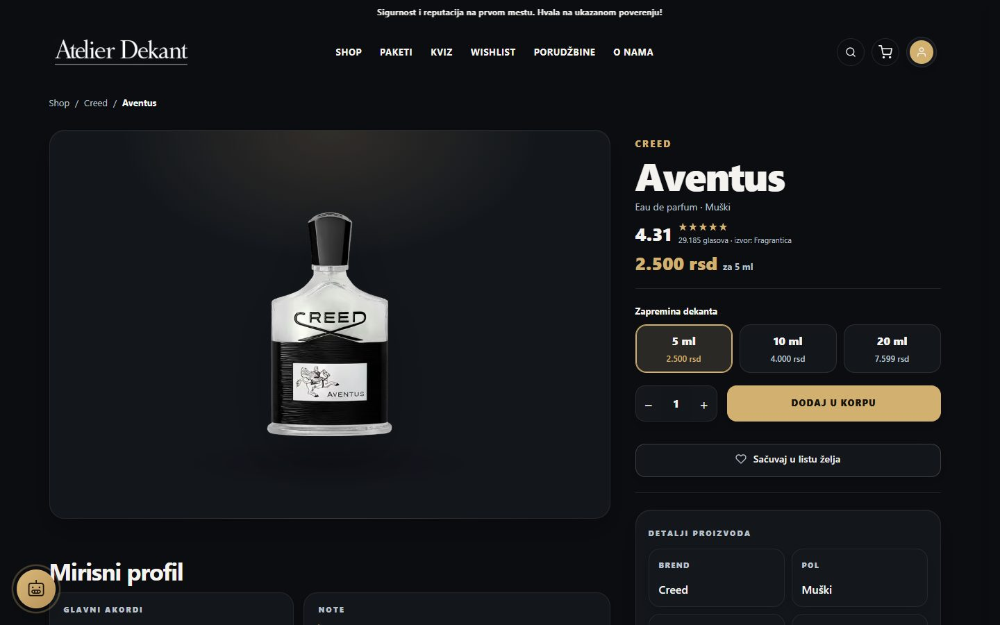
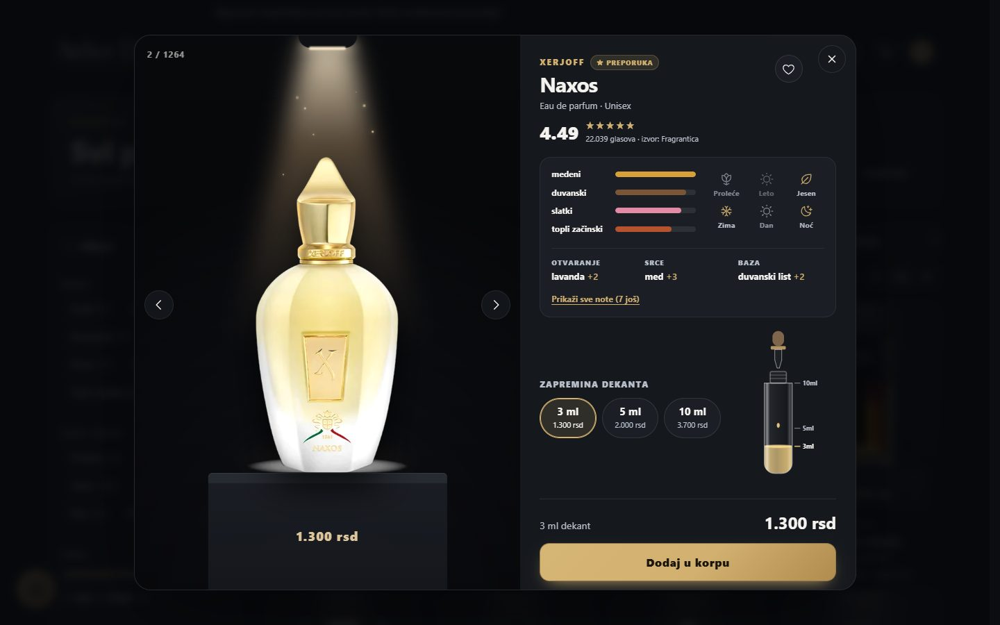
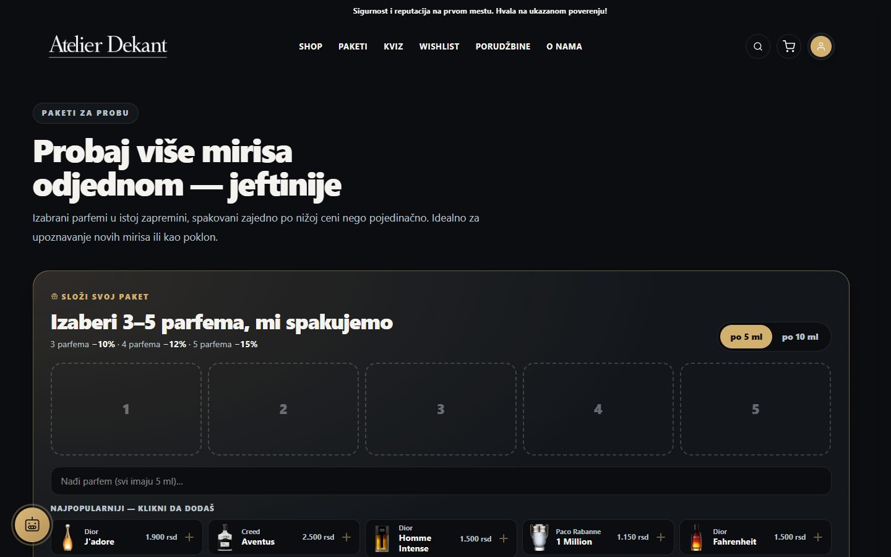
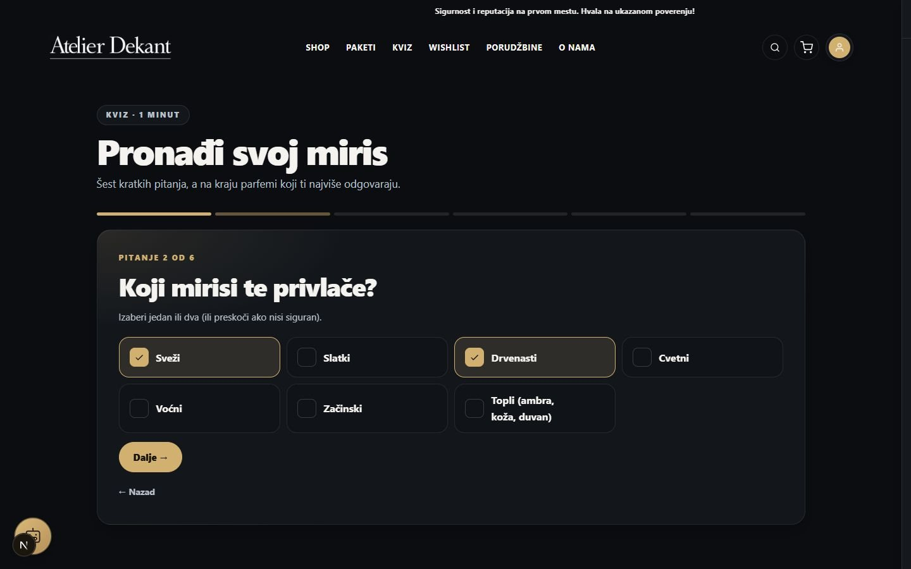
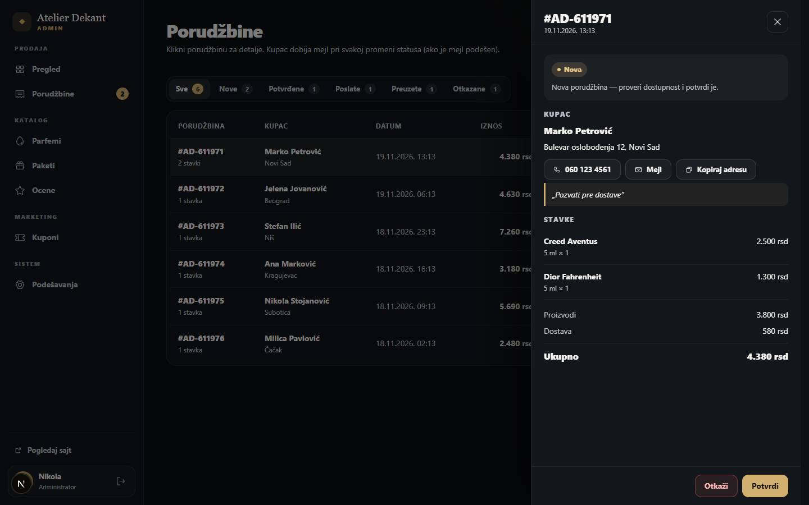
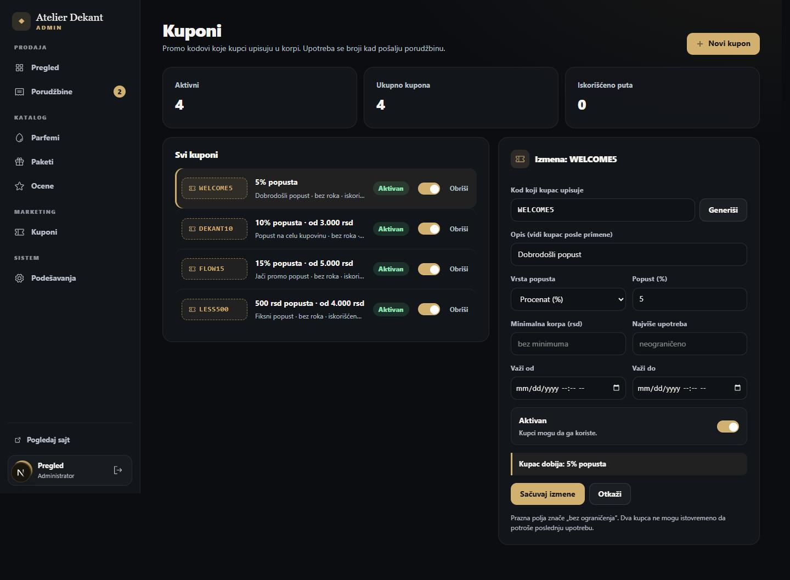
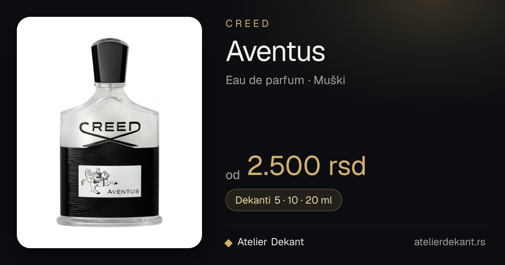
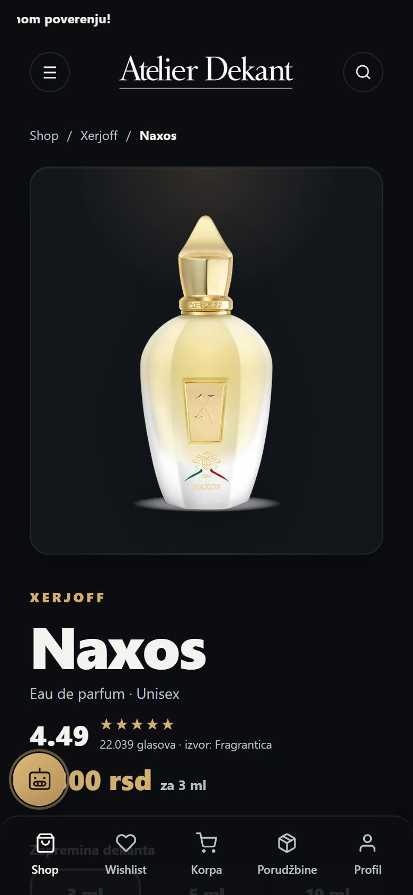

# Atelier Dekant

**A full-stack e-commerce store for perfume decants** — customers buy small samples (3–20 ml) of designer and niche fragrances before committing to a full bottle. 1,200+ products, a custom admin panel, and Serbian instant payments (NBS IPS QR).

**Live:** [atelier-dekant.vercel.app](https://atelier-dekant.vercel.app) · **Demo admin:** see [Try the admin panel](#try-the-admin-panel)



---

## Highlights

- **Catalog of 1,200+ perfumes** with scent profiles (accords, notes, when to wear), filters by scent family and season, search, and a "showroom" quick view.
- **Discovery bundles** — curated sets plus a *build-your-own* bundle (3–5 perfumes, tiered discount) that the server re-prices from live data.
- **Scent quiz** — six questions, then a ranked recommendation from the catalog (weighted accord matching, gender fit, budget).
- **"Similar perfumes"** — cosine similarity over accords + Jaccard similarity over notes, capped at two per brand.
- **Verified customer reviews** — only a customer whose order with that perfume was delivered can review it (enforced by Row Level Security), once per perfume; average, per-star breakdown with filter and sort, editing and deleting your own review, moderation in the admin, and `aggregateRating` in structured data.
- **Brand pages** (`/brendovi`, `/brendovi/dior`) — an A–Z brand index and one statically generated page per brand, with its own metadata, breadcrumbs and sitemap entry.
- **"Javi mi kad bude na stanju"** — customers ask for an email when a sold-out perfume or volume is back; it goes out automatically after a stock top-up, a cancelled order or an admin save. Plus "recently viewed" perfumes (kept only in the browser).
- **Checkout with coupons, free-shipping threshold and live stock** — stock and coupon usage are reserved atomically in Postgres, so two customers can never buy the last decant or the last coupon use at the same time.
- **IPS QR instant payment** — after ordering, the customer gets a QR code (NBS standard, validated against the official NBS validator) to pay from any Serbian banking app.
- **Admin panel** — sales dashboard, orders with status workflow (confirmed → shipped with a Post Express tracking number → delivered), "payment received" flag and customer emails, product editor (images, prices per volume, cost-based price calculator, stock), coupons, bundles, review moderation, shop settings, and a CSV of customers who opted in to news.
- **After-sale emails** — a daily Vercel Cron job asks for a review a few days after delivery; guest orders join the customer's account automatically once they sign in with the same confirmed email.
- **AI assistant** (Claude) — a shopping advisor chat on the storefront and "fill notes from a screenshot" in the admin.
- **Production details** — dynamic Open Graph images per product, JSON-LD structured data, per-page metadata and canonicals, sitemap, consent-gated analytics with withdrawable consent, Serbian consumer-law pages (terms, privacy, cookies, withdrawal form), custom 404/500 pages, loading skeletons, transactional email.

### Lighthouse (mobile, simulated slow 4G)

| Page | Performance | Accessibility | Best practices | SEO |
| --- | --- | --- | --- | --- |
| Home | 92 | 100 | 100 | 100 |
| Shop (1,264 products) | 81 | 100 | 100 | 100 |
| Product | 88 | 100 | 100 | 100 |
| Bundles | 100 | 100 | 100 | 100 |

## Screenshots

| Shop | Product |
| --- | --- |
|  |  |
| **Quick view** | **Discovery bundles** |
|  |  |
| **Scent quiz** | **Admin — orders** |
|  |  |
| **Admin — coupons** | **Link preview (generated per product)** |
|  |  |

<p align="center"></p>

## Tech stack

| Area | Technology |
| --- | --- |
| Framework | **Next.js 16** (App Router, Server Components, Route Handlers, `after()`), **React 19**, **TypeScript** (strict, `exactOptionalPropertyTypes`) |
| Database & auth | **Supabase** — Postgres, Row Level Security, RPC functions, Auth, Storage |
| Styling | CSS Modules with a design-token system (dark/light themes) |
| Email | Resend (HTTP API) |
| AI | Anthropic Claude API |
| Images | `next/image`, `next/og` + `sharp` for generated share cards |
| Testing | **Vitest** (unit), **Playwright** (end-to-end, desktop + mobile) |
| CI | GitHub Actions — lint, type check, unit tests, build, E2E |

## Engineering decisions worth a look

**The server never trusts the cart.** Prices and totals sent by the browser are ignored. [`app/api/orders/route.ts`](app/api/orders/route.ts) uses only product IDs, volumes and quantities: it reloads prices from the database, expands bundles into line items, recomputes the discount, shipping and total, and only then writes the order.

**Race-free stock and coupons.** Stock (in ml per bottle) and coupon usage are changed inside Postgres functions (`consume_perfume_stock`, `redeem_coupon` — see [`db/migrations`](db/migrations)) that check and update in the same transaction — stock rows are locked with `FOR UPDATE` in a consistent order to avoid deadlocks, and the coupon limit is a single conditional `UPDATE`. If anything fails after that point, the API route releases both before returning the error.

**Row Level Security as the last line of defense.** The public Supabase key that every page carries can't read a single shop table: the catalog, prices, bundles and reviews are read only by the server (service role, cached), and orders, stock, costs and coupons are service-role only. A signed-in customer reaches only their own profile, addresses, wishlist, alerts and review. The admin API checks the role on every request, and the read-only demo role is enforced server-side, not just hidden in the UI ([`require-admin.ts`](features/auth/server/require-admin.ts)).

**Hard to scrape.** Nothing can be pulled straight from the database (above). The catalog JSON answers only browsers on the shop's own pages, checked in [`proxy.ts`](proxy.ts), which runs before the CDN cache. AI-training and SEO crawlers are turned away in `robots.txt`. The image optimizer serves only the shop's own images, so it can't be used as a free image proxy, and product photos can't be saved with a right-click or long-press. Vercel's Bot Protection and AI-bot rules at the edge do the heavy lifting.

**Caching that stays correct.** The catalog is cached with `unstable_cache` and tagged; every admin save calls `revalidateTag`, so the shop is fast for visitors and still updates instantly. The 60 most popular product pages are prebuilt; the rest render on first visit and are then cached.

**A 1,264-product shop that stays light.** The shop page ships only the first 24 products in its HTML (same "recommended" order the client uses, so nothing jumps); the full catalog streams in from a CDN-cached JSON route shared with search, the quiz and the wishlist. That cut the shop's HTML from ~1.5 MB to ~100 KB. The list carries only what cards and filters need (no notes, one image); the quick view fetches one perfume's notes when it opens.

**Image processing done once, on the server.** Product photos come from many sources, often on white backgrounds. A flood-fill algorithm removes the background, crops the bottle and estimates the liquid color for the decant animation. It used to run in every visitor's browser (in a **Web Worker** with `OffscreenCanvas`, which already cut the shop's Total Blocking Time from ~670 ms to ~200 ms). Now the same pixel code runs **once per image on the server** with `sharp` when a perfume is saved ([`render-cutout.ts`](features/admin/perfumes/lib/render-cutout.ts)), and the shop shows the finished WebP straight from Storage; the browser path remains as a fallback for images that haven't been processed yet.

**Rate limits that hold on serverless.** In-memory counters reset on every cold start and differ per instance, so the AI chat's daily cap and the coupon brute-force limit live in Postgres (`hit_rate_limit`, one atomic upsert), keyed by an HMAC of the IP rather than the IP itself.

**Bundle pricing that adds up.** [`priceBundle`](features/bundles/lib/bundles.ts) rounds the discounted price down to 10 RSD and distributes it proportionally across items, so line items always sum exactly to the bundle price (covered by tests).

**Honest ratings.** Fragrantica ratings are entered by the admin through a bookmarklet that reads the page they're already viewing — no scraping. A title-matching check warns when the open page looks like a different flanker ("Elixir", "Le Parfum"…). Ratings are shown with their source and are deliberately *not* emitted as `aggregateRating` in structured data, because Google requires those to come from the site's own customers — the shop's own verified reviews are.

**Reviews only from real buyers.** The `product_reviews` RLS policies let a customer insert or edit a review only if they have a delivered order containing that perfume, so the rule holds even for requests that bypass the site. A database trigger sets the public name ("Marko P.") from the profile, so nobody can post under another name. Product pages stay static: reviews are cached per perfume and every write invalidates only that perfume's tag; whether the visitor may write a review is fetched only when the section scrolls into view.

**Instant payments by the spec.** [`features/orders/lib/ips-qr.ts`](features/orders/lib/ips-qr.ts) builds the NBS IPS QR payload, validates the bank account with ISO 7064 MOD 97-10, and refuses to generate a code for an invalid account — a wrong digit would otherwise send money to the wrong place.

## Project structure

```
app/                 Routes (storefront in (site)/, admin/, api/), metadata, OG images, error pages
docs/                Architecture notes, deployment guide, screenshots
features/<domain>/   Feature modules — components/, lib/ (pure logic), server/, client/
  shop, cart, orders, bundles, quiz, admin, notifications, analytics, chat, …
db/
  queries/           All database access (typed query functions)
  migrations/        SQL migrations, applied in order
tests/
  unit/              Vitest — pricing, coupons, shipping, bundles, IPS QR, rating matching, demo masking, reviews,
                     brands, stock alerts, tracking numbers, server image processing, bot filter
  e2e/               Playwright — search, full purchase flow, 404
```

## Getting started

Requirements: Node.js 20+, a Supabase project.

```bash
npm install
cp .env.example .env.local     # fill in Supabase keys (other variables are optional)
```

Apply the SQL files in `db/migrations/` in order (Supabase → SQL Editor), then:

```bash
npm run dev          # http://localhost:3000
```

Optional features turn on when their variables are set (see [`.env.example`](.env.example)): email (Resend), AI assistant (Anthropic), analytics (GA4 / Meta Pixel), IPS QR payments, the daily email job (`CRON_SECRET`, schedule in [`vercel.json`](vercel.json)) and social links.

### Scripts

| Command | What it does |
| --- | --- |
| `npm run dev` | Development server |
| `npm run build` / `npm start` | Production build / server |
| `npm run lint` | ESLint |
| `npm run typecheck` | TypeScript, no emit |
| `npm test` | Unit tests (Vitest) |
| `npm run test:e2e` | End-to-end tests (Playwright; uses the running dev server or starts one) |

## Try the admin panel

A read-only demo account shows the full admin panel. Everything works for browsing; any change is rejected by the server, and customer names, phone numbers, emails and addresses are masked.

- URL: [atelier-dekant.vercel.app/admin](https://atelier-dekant.vercel.app/admin)
- Email: *available on request*
- Password: *available on request*

## Tests

```
✓ tests/unit  80 tests — pricing, coupons, shipping, bundles, IPS QR, rating matching, demo masking, reviews, brands, stock alerts, tracking, server image processing, bot filter, robots.txt
✓ tests/e2e    6 tests — search, full purchase flow (product → cart → coupon → checkout → confirmation), 404 — desktop and mobile
```

The E2E suite intercepts the order and coupon endpoints, so it exercises the real UI without writing to the database.

---

Built by [FlowiXx00](https://github.com/FlowiXx00).
